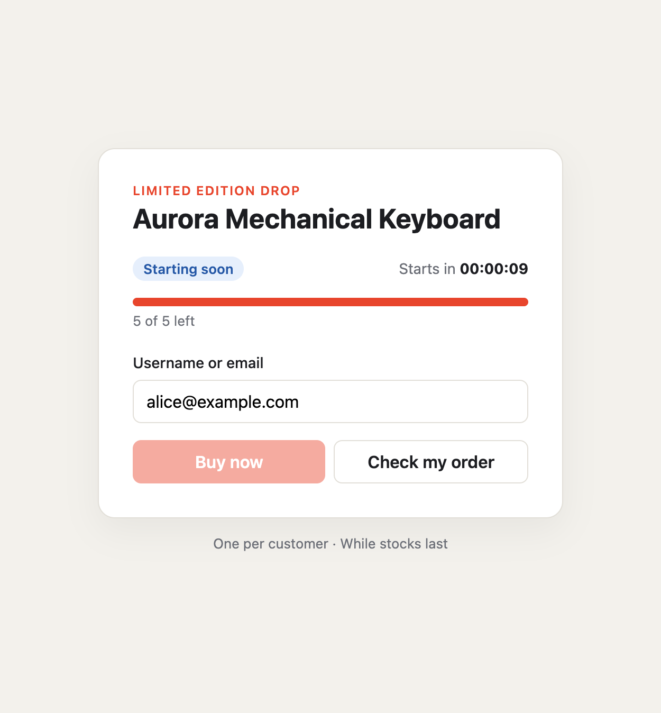
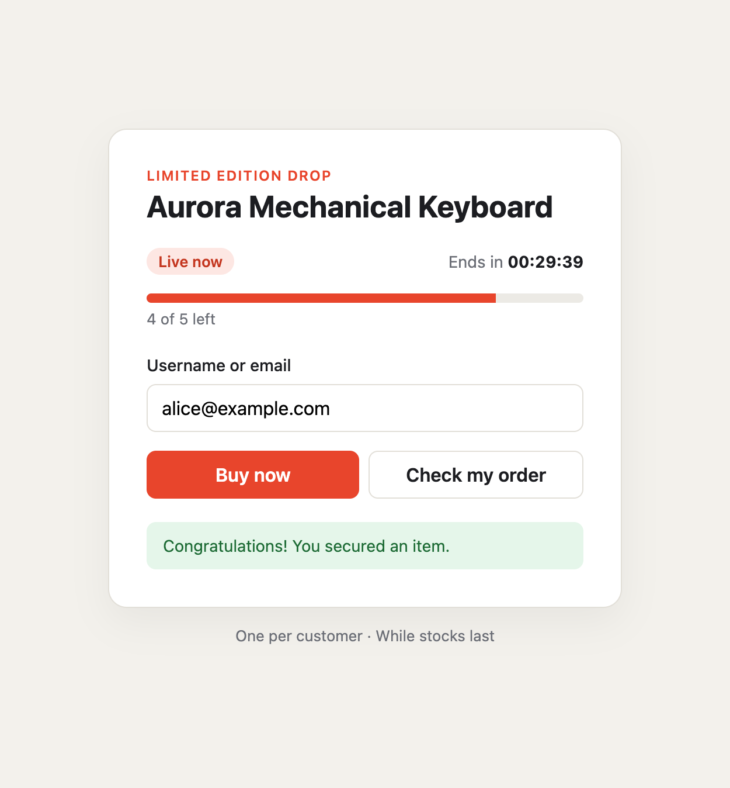
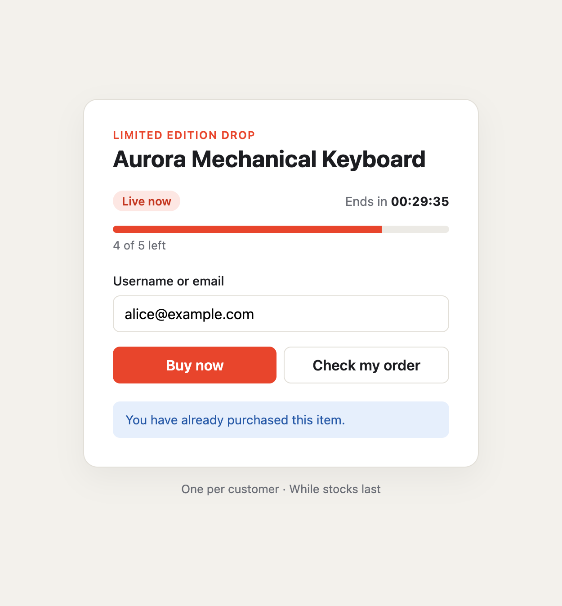
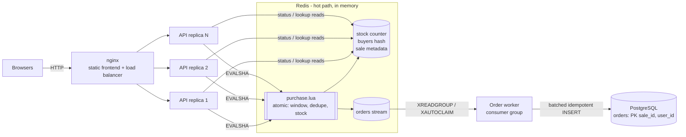
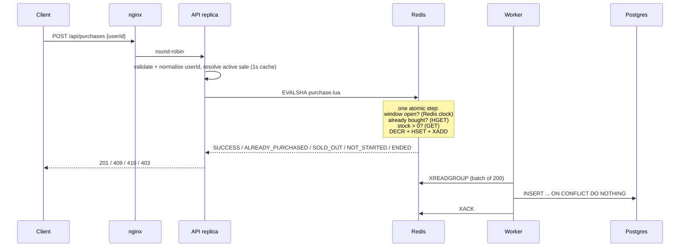

# Flash Sale System

A high-throughput backend and React frontend for a flash sale of a single product with limited stock: a configurable sale window, strict one-item-per-user, and no overselling under heavy concurrency.

- **API**: Node.js 24, TypeScript, Fastify (stateless, horizontally scaled)
- **Inventory / concurrency control**: Redis 7, one atomic Lua script per purchase
- **Order hand-off**: Redis Streams (consumer group, at-least-once)
- **System of record**: PostgreSQL (orders table, idempotent inserts)
- **Frontend**: React 19 + Vite, served by nginx, which also load-balances the API replicas
- **Tests**: Vitest (unit, API, Redis/Postgres integration) and a custom stress / fault-injection harness

| Upcoming | Purchased | Repeat attempt |
| --- | --- | --- |
|  |  |  |

---

## Quick start

Requires Docker and Node.js 20+ (24 recommended).

```bash
npm install
docker compose up -d --build --wait     # redis, postgres, 3x api, worker, nginx+frontend
open http://localhost:8080
```

By default a sale called `launch` with 100 items opens immediately and runs for 2 hours. Configure it with environment variables before `docker compose up`:

```bash
SALE_ID=drop-1 SALE_STOCK=500 \
SALE_STARTS_AT=2026-10-13T10:00:00Z SALE_ENDS_AT=2026-10-13T11:00:00Z \
docker compose up -d --build --wait
```

The env config only seeds a sale if none exists yet, so restarting a container never resets stock. To start a new sale at runtime (this is what the stress test does):

```bash
curl -X PUT localhost:8080/api/admin/sale \
  -H 'content-type: application/json' -H 'x-admin-token: dev-admin-token' \
  -d '{"id":"drop-2","startsAt":"2026-10-13T10:00:00Z","endsAt":"2026-10-13T11:00:00Z","totalStock":50}'
```

Stop everything with `docker compose down` (add `-v` to wipe Redis and Postgres data).

### Running locally without Docker

The API can run with an in-memory store (single process, no persistence). It is meant for trying the UI only:

```bash
STORE=memory npm run dev:server   # API on :3000
npm run dev:web                   # Vite on :5173, proxies /api to :3000
```

With Redis and Postgres available (for example `docker compose up -d redis postgres`), run `npm run dev:server`, `npm run dev:worker` and `npm run dev:web`.

---

## Architecture



### Purchase path



### Components and why

| Component | Role |
| --- | --- |
| nginx | Serves the built React app and round-robins `/api` across API replicas |
| API (Fastify) | Stateless: validation, HTTP mapping, small read caches. Scales horizontally |
| Redis | Source of truth for stock and buyers during the sale; runs the atomic purchase |
| Redis Stream | Durable buffer that decouples the hot path from the database |
| Order worker | Drains the stream into Postgres in batches, with crash recovery |
| PostgreSQL | Long-term system of record, with a primary key as a second uniqueness guard |

---

## Design choices and trade-offs

### 1. Concurrency control: one atomic Lua script in Redis

The whole decision runs as one Lua script ([`server/src/store/redisStore.ts`](server/src/store/redisStore.ts)): is the window open, has this user bought, is there stock, then decrement, record the buyer and enqueue the order. Redis executes scripts one at a time, so no two purchases can interleave. Overselling and double-buying are impossible by construction, with no locks, retries or transactions to tune.

Alternatives considered:

- **Postgres row locks (`SELECT ... FOR UPDATE`) or `UPDATE stock SET n = n - 1 WHERE n > 0`.** Correct, but every buyer contends on one hot row. Throughput is bounded by lock hold time and connection pool size, and the database most needed for durable records becomes the bottleneck.
- **Distributed locks (Redlock).** Extra round trips and lock-expiry edge cases, for a guarantee a single script already gives.
- **Plain `DECR` then compensate with `INCR` when negative.** Atomic for stock, but checking "already bought" separately opens a race where the same user wins twice from two tabs. The script checks both together.

Details that matter:

- **The Redis server clock decides the sale window** (`TIME` inside the script), so API replicas with skewed clocks cannot disagree about whether the sale is open.
- **The duplicate check comes before the stock check.** A buyer who clicks again after the sale sells out sees "already purchased", not "sold out".
- **User ids are normalised** (trimmed, lower-cased, restricted charset) before they reach Redis, so `Alice@x.com` and `alice@x.com` count as the same buyer.
- **All keys share the `{fs}` hash tag**, so the multi-key script also works on Redis Cluster.

### 2. Keep the hot path in memory; persist asynchronously

A purchase costs the API one Redis round trip. The durable write to Postgres happens off the request path: the script appends the order to a Redis Stream in the same atomic step, and a worker batches those orders into Postgres. Consequences:

- A traffic spike never reaches the database. Postgres sees one batched insert per 200 orders, and total writes are bounded by the stock size, not the traffic.
- The stream entry is written atomically with the stock decrement, so there is no "decremented but never enqueued" gap (the usual dual-write problem).
- Delivery is **at-least-once**. The worker ACKs only after the insert commits, and `XAUTOCLAIM` takes over entries left pending by a crashed consumer. Inserts use `ON CONFLICT DO NOTHING` on `PRIMARY KEY (sale_id, user_id)`, so redelivery cannot duplicate an order. The primary key is also a second, independent guard for one-item-per-user.
- **Trade-off:** Postgres is eventually consistent, typically within milliseconds. While the sale is running, Redis is the read model for "did I buy?".

### 3. Stateless, horizontally scalable API

The API holds no state that affects correctness, so you can add replicas behind the load balancer (Compose runs 3). Two small in-process caches reduce Redis load:

- **Active-sale config, 1s TTL.** This only selects *which* sale to target. Whether it is open is still decided atomically in Redis, so a stale cache cannot let a purchase through outside the window.
- **Status response, 250ms TTL, with in-flight de-duplication.** The status endpoint is polled by every client. Thousands of concurrent polls become one Redis call per replica every 250ms.

Request logging is off on the hot path (it costs measurable throughput at 20k req/s), and the request body is capped at 1 KB.

### 4. Failure handling

| Failure | Behaviour |
| --- | --- |
| Redis unreachable or slow | The client fails fast (offline queue off, 2s command timeout), and the API answers `503` instead of piling up requests. The frontend retries with jittered exponential backoff |
| Response lost after a purchase committed (timeout, dropped connection) | Retrying is safe: the repeat returns `ALREADY_PURCHASED` with the original timestamp. Purchases are idempotent per user |
| API replica crashes | nginx marks it failed and stops routing to it. In-flight requests on that replica get `502`, and nginx does not resend them to another replica (`proxy_next_upstream error`). Docker restarts the replica |
| Worker crashes or Postgres is down | Orders wait in the stream and nothing is lost. On recovery the worker (or another consumer) reclaims pending entries |
| Process restart during a sale | Seeding uses "create only if no active sale", so stock and buyers are never reset |
| Redis crash | AOF with `appendfsync everysec`. Each purchase script is replayed atomically, so a restore can never oversell, but the last ~1s of acknowledged purchases could be lost (see below) |

**Known limits, and what I'd do in production:**

- **Redis is a single point of failure here.** In production, use a managed primary/replica setup (ElastiCache, Memorystore) with automatic failover. Replication is asynchronous, so failover can lose acknowledged writes. If that is unacceptable, call `WAIT 1 <timeout>` after a successful purchase (costs one replica round trip), or use `appendfsync always`.
- **Every replica polls Redis for sale status.** At much larger scale, serve `GET /api/sale` from a CDN with a 1s TTL, or push updates over SSE/WebSocket.
- **There is no bot protection or rate limiting.** That belongs at the edge (WAF, CDN rate limits, CAPTCHA, or a virtual waiting room), not in the API. Doing it per IP inside the API would also throttle the stress test, which runs from one IP.
- **The admin endpoint is protected only by a shared token.** That is fine for a demo; production needs real auth.

### 5. Scaling further

- **More API throughput:** add replicas. Each one is a thin layer over Redis.
- **Beyond one Redis primary:** stock for one product is inherently a single hot key, but one Redis core handles roughly 100k script calls per second. Past that, split stock into N buckets on different shards (`{fs:0}`, `{fs:1}`, ...) and route each user to a bucket by hashing their id. A user then always hits the same bucket, which keeps the duplicate check local, and you can rebalance leftovers at the end of the sale.
- **Cheaper rejections after a sellout:** replicas could cache "sold out" briefly and reject at the edge. I left this out so repeat buyers still get an accurate "already purchased".

---

## API

| Method | Path | Responses |
| --- | --- | --- |
| `GET` | `/api/sale` | `200` `{ saleId, status: upcoming \| active \| sold_out \| ended \| no_sale, startsAt, endsAt, totalStock, stockRemaining, serverTime }` |
| `POST` | `/api/purchases` with body `{ "userId": "alice@example.com" }` | `201 SUCCESS`, `409 ALREADY_PURCHASED`, `410 SOLD_OUT`, `403 NOT_STARTED / ENDED`, `404 NO_SALE`, `400` invalid id, `503` store unavailable (safe to retry) |
| `GET` | `/api/purchases/:userId` | `200` `{ userId, saleId, purchased, purchasedAt }` |
| `PUT` | `/api/admin/sale` (header `x-admin-token`) | `201` `{ saleId }`. Starts a new sale and closes the previous one |
| `GET` | `/api/health` | `200` / `503` depending on Redis reachability |

Purchase responses always include `outcome`, `message`, `userId` and `purchasedAt`.

---

## Tests

```bash
docker compose up -d redis postgres --wait   # needed for the integration suites
npm test                                     # server + web
```

Integration suites skip themselves (with a warning) if Redis or Postgres is not reachable, so `npm test` also works without Docker, with reduced coverage. Use `REDIS_TEST_URL` / `DATABASE_TEST_URL` to point them elsewhere. They use Redis DB 15 and never touch dev data.

| Suite | What it covers |
| --- | --- |
| `server/test/unit/sale.test.ts` | Status transitions at window boundaries, user-id normalisation, config validation |
| `server/test/unit/saleService.test.ts` | Status lifecycle, cache TTLs, collapsing concurrent reads into one store call |
| `server/test/contract/saleStoreContract.ts` | **One behaviour suite run against both the in-memory store and real Redis**: window enforcement, one-per-user, sold-out, zero stock, reconfiguration, and 2,000 concurrent attempts from 500 users for 100 items |
| `server/test/api/api.test.ts` | Every endpoint and status code via `fastify.inject`, validation, 503 mapping, concurrent HTTP purchases, admin auth |
| `server/test/integration/redisStore.test.ts` | Exactly one stream entry per sale; 8 independent connections (like replicas) racing 4,000 attempts for 250 items |
| `server/test/integration/orderWorker.test.ts` | Stream to Postgres persistence and ACKs; **crash recovery** (a failing consumer's entries are reclaimed by another); idempotent redelivery |
| `web/src/App.test.tsx` | Status display, button enablement, feedback for each outcome, retry after 503, order lookup |

---

## Stress tests

The harness ([`server/stress/stress.ts`](server/stress/stress.ts)) creates a fresh sale through the admin API. It then sends `users × attempts` purchase requests in shuffled order (so one user's duplicate attempts race each other) at a fixed concurrency through nginx, and finally checks the invariants against the server:

1. exactly `min(stock, users)` items were sold: no oversell, no undersell
2. no user received `SUCCESS` more than once
3. remaining stock equals `stock - sold`
4. `GET /api/purchases/:id` for **every** user matches the responses that user received
5. with `--verify-db`: Postgres contains exactly the winners, no more and no fewer
6. no 5xx or transport errors (relaxed by `--allow-errors` for fault-injection runs)

The process exits non-zero if any check fails.

```bash
docker compose up -d --build --wait
npm run stress -- --verify-db                                    # 10k users x 3 attempts, 500 items
npm run stress -- --verify-db --users 50000 --stock 2000 --attempts 2 --concurrency 1000
npm run stress -- --verify-db --users 300 --stock 1000 --attempts 5   # more stock than buyers
npm run stress:chaos                                             # fault injection (below)
```

Options: `--url` (default `http://localhost:8080`), `--users`, `--stock`, `--attempts`, `--concurrency`, `--admin-token`, `--verify-db`, `--database-url`, `--allow-errors`.

### Results

Measured on an Apple Silicon laptop with everything (3 API replicas, nginx, Redis, Postgres, worker and the load generator) running on the same machine under Docker Desktop. Absolute numbers are limited by that setup; the correctness results are what matter.

**10,000 users × 3 attempts, 500 items, 500 concurrent connections**

```
throughput      17558 req/s
latency (ms)    p50 20.9 | p95 67.6 | p99 190.8 | max 433.6
status codes    201: 500, 409: 1000, 410: 28500
PASS  exactly min(stock, users) items sold (500)
PASS  no user won more than once (500 distinct winners)
PASS  remaining stock is consistent (stockRemaining=0, status=sold_out)
PASS  purchase lookups match responses (0 mismatches across 10000 users)
PASS  no 5xx or transport errors
```

**50,000 users × 2 attempts, 2,000 items, 1,000 concurrent connections**

```
throughput      18022 req/s
latency (ms)    p50 43.0 | p95 124.7 | p99 321.5 | max 1007.1
status codes    201: 2000, 409: 2000, 410: 96000
PASS  ... all invariants
PASS  worker persisted exactly the winners to Postgres (2000 rows)
```

**More stock than buyers: 300 users × 5 attempts, 1,000 items.** 300 `SUCCESS` and 1,200 `ALREADY_PURCHASED`; `stockRemaining=700`; Postgres has 300 rows. No user can buy a second item even though stock remains.

How to read these numbers:

- The status-code mix is exactly what the rules predict. Each of the `stock` winners gets one `201`. Their other attempts get `409` only if they arrived after the winning one. Everyone else gets `410`. No request returns `201` beyond the stock.
- Most requests are rejections (`410`) that go through the same atomic script, so throughput is about the same before and after the sellout.
- The tail latency (p99, max) is most likely CPU contention: one laptop runs the load generator, nginx and every service at once. The Redis script itself runs in microseconds.

### Fault injection: `npm run stress:chaos`

This runs the 50k-user load with the order worker stopped, hard-kills (`docker kill`) one API replica about 3.5s into the run, then restarts both:

```
status codes    201: 2000, 409: 1998, 410: 95951, 502: 51
PASS  exactly min(stock, users) items sold (2000 sold / expected 2000)
PASS  no user won more than once (2000 distinct winners)
PASS  remaining stock is consistent (stockRemaining=0, status=sold_out)
PASS  purchase lookups match responses (0 mismatches across 50000 users)
PASS  worker persisted exactly the winners to Postgres (2000 rows)
```

The ~50 requests in flight on the killed replica got `502` from nginx (their outcome is unknown to the client, which would retry safely). The other replicas absorbed the traffic. Orders piled up in the stream while the worker was down, and were all persisted, exactly once, after it came back.

---

## Project layout

```
docker-compose.yml          redis, postgres, api (x3), worker, web
server/
  src/
    domain/sale.ts          types, status computation, validation (pure)
    store/redisStore.ts     Lua scripts: atomic purchase + sale configuration
    store/memoryStore.ts    same contract, in-process (tests / no-Docker demo)
    service/SaleService.ts  caching and orchestration
    app.ts                  Fastify routes and HTTP mapping
    worker/OrderWorker.ts   Redis Stream -> Postgres, with crash recovery
    db/orderRepository.ts   idempotent batched inserts
    server.ts, worker.ts    process entry points
  test/                     unit, api, contract, integration
  stress/                   stress.ts, chaos.sh
web/
  src/App.tsx               UI
  src/api.ts                API client (with safe retries)
  nginx.conf                static hosting + API load balancing
```
